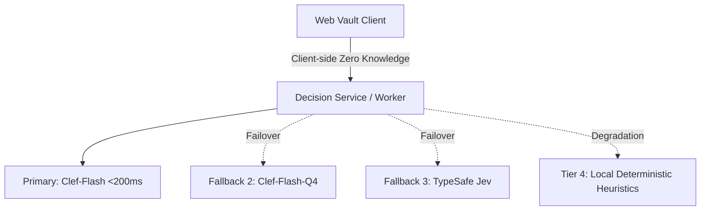

# Design: Clef Edge Decision Intelligence Architecture

## System Architecture

## Security & Privacy Guardrails
1. **Zero-Knowledge Principle**: Passwords, encryption keys, decrypted notes, and full usernames are NEVER transmitted to external inference endpoints.
2. **Deterministic Fallback Engine**: If network or remote inference fails, regex pattern matching (CIDR blocks, internal hostnames, financial keyword matching) immediately executes locally.
3. **Model Hallucination Guard**: Overrides model responses that assign low severity (`P2`/`P3`) to credentials that have confirmed database leaks (`exposedCount > 0`).

## UI / UX Integration
- **Vault List**: Visual badges (`🚨 P0`, `⚠️ P1`, `🛡️ P2`) on individual item cards.
- **Sidebar**: Real-time counter of total unaddressed security risks.
- **Smart Categorization Dialog**: Grouped review by target folder, folder creation handling, and batch move action.
